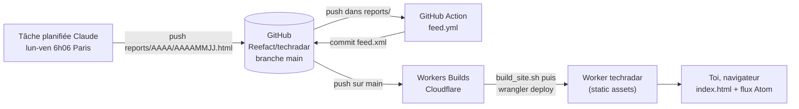
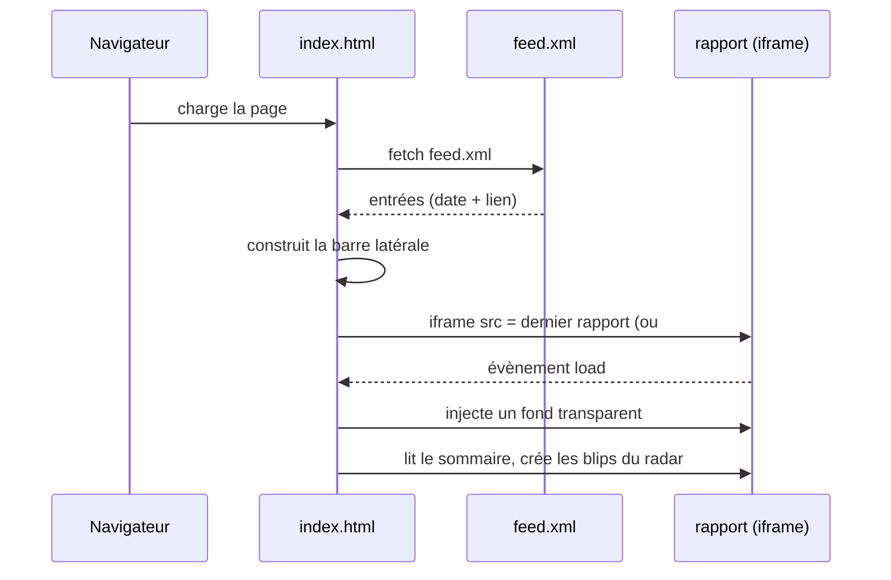

# Architecture

## Vue d'ensemble

Tout est **statique** : pas de base de données, pas de code serveur. Le « backend » est la tâche planifiée qui écrit des fichiers HTML dans Git.

## Structure du dépôt

| Chemin | Rôle |
|---|---|
| `index.html` | Page d'accueil : bandeau, barre latérale, rapport en iframe, radar animé |
| `reports/AAAA/AAAAMMJJ.html` | Un rapport par jour (publié, listé dans l'index et le flux) |
| `drafts/AAAA/AAAAMMJJ-HHMM.html` | Versions régénérées d'un jour déjà publié (jamais listées) |
| `assets/report.css` | Feuille de style partagée par tous les rapports |
| `assets/favicon.svg`, `favicon-32.png`, `apple-touch-icon.png` | Icône radar du site (index et rapports) |
| `feed.xml` | Flux Atom **généré** ; sert aussi de liste de découverte pour l'index |
| `tools/build_feed.py` | Génère `feed.xml` à partir des rapports |
| `tools/build_site.sh` | Assemble `dist/` (ce qui est réellement déployé) |
| `tools/report-template.html` | Gabarit que la tâche de veille doit suivre |
| `wrangler.jsonc` | Config Cloudflare (Worker `techradar`, assets dans `dist/`) |
| `.github/workflows/` | `feed.yml` (flux automatique), `promote.yml` (promotion manuelle) |
| `.claude/skills/promote-draft/` | Skill Claude Code pour promouvoir un brouillon |
| `docs/` | Cette documentation |

## Le site

### Page d'accueil (`index.html`)
- **Bandeau fixe** : nom, description, bouton « S'abonner » (flux Atom).
- **Barre latérale** : rapports classés par mois et par jour.
- **Découverte** : au chargement, le JavaScript lit `feed.xml` (un `fetch`) et en tire la date et le lien de chaque rapport. Il n'y a donc pas de liste à maintenir à la main. Cela exige un serveur HTTP : `index.html` ne marche pas en `file://`.
- **Navigation** : le rapport choisi s'affiche dans une **iframe** ; l'URL garde le jour dans le hash (`index.html#2026-11-24`). Par défaut, le plus récent.

### Radar d'arrière-plan
Trois couches empilées derrière l'iframe, plus un voile CRT par-dessus :
1. **Cadran** (canvas peint une seule fois) : anneaux, graduations, relèvements, échelle.
2. **Balayage** : un `conic-gradient` qui tourne via l'API d'animation du navigateur (un tour = 16 s).
3. **Blips** (petit canvas redessiné en continu) : un point carré par article du sommaire, coloré par catégorie ; il s'allume quand le faisceau passe dessus. S'y ajoutent des « échos » (anneaux) et de la poussière de phosphore.
- Le radar suit légèrement le défilement du rapport (parallaxe).
- `prefers-reduced-motion` : radar statique. L'animation se met en pause quand l'onglet est caché.
- Les blips dépendent du fait que l'iframe est de même origine (c'est le cas sur le site déployé).

### Un rapport
- Un fichier HTML qui suit `tools/report-template.html`, avec `assets/report.css` en `<link>`.
- **Obligatoires** : `<title>`, `<meta name="date" content="AAAA-MM-JJ">` (l'index et le flux s'en servent), le bloc `
` (résumé du flux), et dans le sommaire un `` par catégorie suivi de ses `<a class="item">` (les blips en dépendent).
- Ouvert seul, un rapport est lisible avec son thème (sans le radar).

### Style
Thème sombre noir-vert, accent turquoise, couleurs par catégorie. Polices Google Fonts : **VT323** (titres), **IBM Plex Sans** (texte), **IBM Plex Mono** (badges). C'est un appel externe ; elles pourraient être hébergées dans `assets/fonts/`.

### Flux Atom
`feed.xml` : une entrée par rapport (titre, date, lien, résumé = les puces « À retenir »). Les liens sont relatifs tant que la variable `SITE_URL` n'est pas définie.
