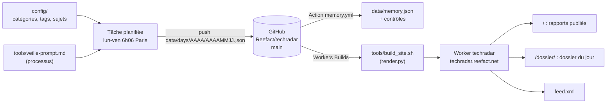

# Architecture

## Vue d'ensemble

Tout est **statique**. La source de vérité est un **fichier de données par jour** (`data/days/AAAA/AAAAMMJJ.json`) qui contient tous les sujets analysés avec leur statut ; le site est **rendu** à partir de ces fichiers au moment du déploiement. La tâche planifiée n'écrit jamais de HTML.

## Structure du dépôt

| Chemin | Rôle |
|---|---|
| `config/categories.json` | Catégories : clé stable → libellé, libellé de carte, classe CSS, préfixe d'identifiant, ordre, minimum, plafond, description |
| `config/tags.json` | Tags (badges) : clé stable → libellé, classe CSS, description (règle d'application) |
| `config/sujets.json` | Index des fichiers « quoi chercher » (chemin, rôle, actif) |
| `config/sujets/` | `perimetre.json` (priorités, exclusions, fenêtre, volumes), `sources.json`, `recherche/<catégorie>.json`, `outils.json`, `radar.json`, `conferences.json` |
| `data/days/AAAA/AAAAMMJJ.json` | Fichier du jour : sujets (publiés, candidats, mis de côté, écartés), « À retenir », journal de recherche, exécutions |
| `data/demande.json` | (Ponctuel) demande de l'utilisateur pour la prochaine exécution : date cible, consignes |
| `data/memory.json` | Mémoire dérivée des jours (générée par l'Action, ne pas éditer) |
| `data/notes.md` | Notes non déductibles (préférences, versions vues, vérifications en attente) |
| `tools/veille-prompt.md` | Processus de la tâche (comment travailler) |
| `tools/veille-bootstrap.md` | Texte d'amorçage collé dans la tâche (il lui fait lire le processus) |
| `tools/veille_lib.py` | Fonctions partagées : configuration, Markdown simple, dates |
| `tools/render.py` | Rendu : rapports publiés, dossiers du jour, `dossier.json`, flux Atom |
| `tools/check_config.py` | Validation de la configuration |
| `tools/check_day.py` | Validation d'un fichier du jour (schéma, volumes, radar, journal, immuabilité, rendu, langue) |
| `tools/check_report.py` | Contrôle du HTML rendu (structure, liens, signaux de langue) ; appelé par `check_day.py` |
| `tools/statut.py` | Change le statut de sujets (utilisé par le skill `veille-publier`) |
| `tools/build_memory.py` | Mémoire : `--seen`, `--due`, `--reconsiderer` |
| `tools/build_site.sh` | Build Cloudflare : contrôle de la configuration, rendu, interface → `dist/` |
| `index.html`, `dossier/index.html` | Interface : accueil (rapports publiés) et page du dossier du jour |
| `assets/` | `site.css`, `site.js` (interface et radar), `report.css` (rapports et dossiers), icônes Reefact |
| `.github/workflows/memory.yml` | Contrôles et régénération de la mémoire à chaque push |
| `.claude/skills/` | Skills Claude Code : voir [skills.md](skills.md) |
| `wrangler.jsonc` | Configuration Cloudflare (Worker `techradar`, assets dans `dist/`) |
| `docs/` | Cette documentation |

## Le fichier du jour

Un sujet a un **statut** : `publie` (dans le rapport) · `candidat` (bon, non retenu ou trouvé lors d'une relance) · `mis-de-cote` (à réexaminer) · `ecarte` (avec un motif : `deja-publie`, `hors-fenetre`, `hors-perimetre`, `non-verifiable`, `doublon`, `trop-mineur`, `plafond-atteint`, `exclu-config`, `rien-de-neuf`).

Champs principaux d'un sujet : `id` (préfixe de catégorie + numéro), `categorie`, `statut`, `motif`, `tags`, `titre`, `resume` (Markdown simple), `pourquoi`, `details`, `sources`, `meta` (ligne sous le titre), `date` (parution, sert au repère « frais »), `depot` (radar), `conference` (dates, lieu, CFP), `historique`. Le détail est dans [`tools/veille-prompt.md`](../tools/veille-prompt.md) (§4) et la référence est le fichier existant `data/days/2026/20261124.json`.

Le texte est en **Markdown simple** (`**gras**`, `` `code` ``, `[texte](https://…)`, paragraphes, listes « - ») ; le rendu garantit les classes CSS, les ancres, `target="_blank"` sur les liens externes, les badges et `data-repo`.

## Le site

### Accueil (`/`)
Bandeau « Reefact | TechRadar » (liens vers reefact.net et vers l'accueil), barre latérale des rapports publiés (découverts via `feed.xml`), rapport affiché en iframe (le jour dans l'adresse : `/#2026-11-24`, par défaut le plus récent), radar animé en fond (les « blips » viennent des sujets du rapport), boutons « Claude » / « Claude Code » sur chaque sujet, liens externes en nouvel onglet.

### Dossier du jour (`/dossier/`)
Même interface, mais la barre latérale liste les jours (avec le nombre de sujets à revoir) et l'iframe affiche le **dossier** : journal de recherche (repliable), compteurs par statut, tous les sujets dans les mêmes blocs dépliants que le rapport (badge de statut en tête ; motif dans le bloc d'un écarté), la même barre de filtres avec un groupe « Statut » en plus, et un bouton « Demander la publication » sur chaque sujet non publié qui copie la demande à coller dans Claude (sur la même ligne que le bouton Claude). Pas de légende : chaque badge affiche sa description au survol. Non indexé par les moteurs. L'ancienne adresse `/drafts/` redirige ici.

### Rapport publié (`/reports/AAAA/AAAAMMJJ`)
Rendu des seuls sujets publiés : « À retenir », puis la liste des sujets en blocs dépliants (fermés : badges, titre, ligne « source · date » ; un clic ouvre le résumé, un clic sur l'en-tête ou le chevron ⌃ le replie), barre de filtres (catégories, tags, « frais » ; OU dans un groupe, ET entre groupes ; « Tout déplier »), bouton flottant « Revenir en haut », pied de page. Chaque badge affiche sa description au survol. Un point vert marque un sujet **frais** : sa `date` est postérieure ou égale à celle du brief précédent. Comportement dans `assets/report.js` ; sans JavaScript, les blocs restent dépliables. Titre d'onglet : « Veille technologique du mardi 24 novembre 2026 – Reefact ».

### Boutons « Claude » sur chaque sujet
L'interface ajoute un bouton sous chaque sujet : « Claude Code » (violet) pour un sujet du radar, qui ouvre `claude.ai/code` avec le dépôt présélectionné et le prompt pré-rempli (non envoyé) ; « Claude » (turquoise) pour les autres, qui ouvre `claude.ai/new` et copie aussi le prompt dans le presse-papiers.

### Style
Thème sombre noir-vert, accent turquoise, « Reefact » en bleu (#5eaedb, couleur du logo). Polices Google Fonts : VT323 (titres), IBM Plex Sans (texte), IBM Plex Mono (badges). Icônes du site = logo Reefact.

### Flux Atom
`feed.xml` : une entrée par jour publié (titre, lien, résumé = « À retenir »), liens absolus grâce à la variable `SITE_URL` du build.
