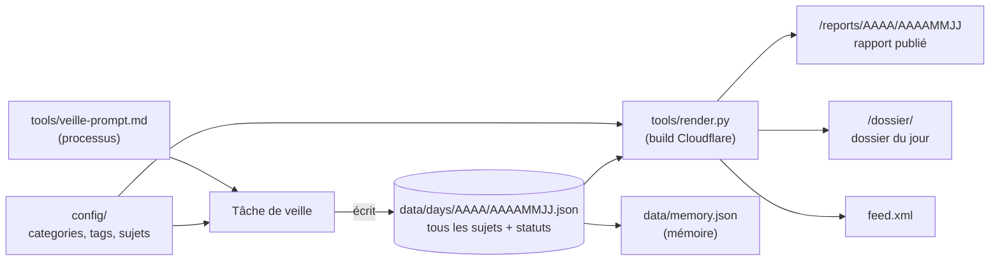
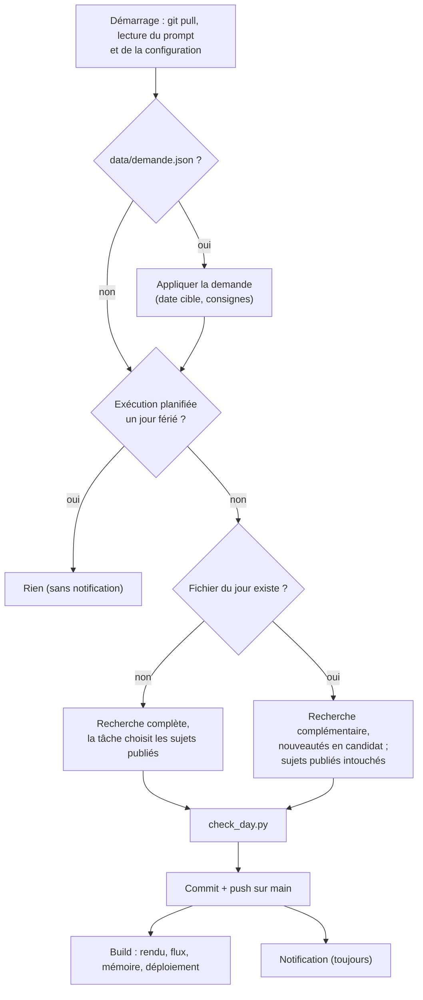

# Conception v2 : une source de données par jour

Statut : **réalisée le 24 novembre 2026**. Ce document garde le raisonnement et les choix ; le fonctionnement est décrit dans [architecture.md](architecture.md), [generation.md](generation.md), [deploiement.md](deploiement.md) et [skills.md](skills.md).

> **Évolution après la mise en place** : la section « En bref » a été supprimée (chaque brève devient un sujet), le sommaire et le tableau des conférences ont laissé place à des blocs dépliants avec filtres, et chaque sujet porte une `date` qui alimente le repère « frais ». L'état courant est décrit dans [architecture.md](architecture.md).

## 1. Pourquoi changer

| Problème actuel | Conséquence |
|---|---|
| Un brouillon est un **second rapport HTML complet** | Reprendre un sujet de l'un à l'autre exige de la chirurgie HTML (`merge_topic.py`) |
| Les **sujets écartés** ne sont gardés nulle part | Impossible de vérifier le tri, ni l'effort de recherche ; un sujet « à revoir demain » est perdu |
| Le **modèle écrit du HTML** | Les règles (liens `_blank`, ancres, badges, `data-repo`) dépendent de son application ; il faut les contrôler après coup |
| **Le quoi chercher** est noyé dans 22 000 caractères de prompt | Changer un sujet = éditer un long texte, diff peu lisible |
| Les **minimums** sont écrits deux fois (prompt et validateur) | Ils peuvent diverger |

## 2. Principes

1. **Une seule source par jour** : un fichier de données `data/days/AAAA/AAAAMMJJ.json` qui contient **tous** les sujets analysés, avec leur statut.
2. **Deux vues rendues** à partir de ce fichier : le **rapport publié** (sujets publiés seulement) et le **dossier du jour** (tous les sujets).
3. **Le modèle produit des données, pas du HTML.** Un script de rendu garantit la mise en forme.
4. **La configuration est séparée du processus** : catégories, tags et sujets de veille vivent dans des fichiers JSON dédiés, une responsabilité par fichier.
5. **Un sujet publié est immuable pour la tâche** : une relance n'ajoute que des candidats.



## 3. Arborescence cible

```
config/
  categories.json            catégories : clé stable → libellé, description, ordre, min, max
  tags.json                  tags : clé stable → libellé, description (règle d'application)
  sujets.json                index des fichiers de sujets : chemin, rôle, actif
  sujets/
    perimetre.json           sujets prioritaires (tag tes-sujets), exclusions globales, fenêtre de dates, langue
    sources.json             sources à toujours consulter / à ignorer, sources françaises préférées
    recherche/<categorie>.json   une consigne de recherche par catégorie (alertes, dotnet, ia, ddd, api, distribution)
    outils.json              découverte des outils : sources, composition (utiles + pépite), critères
    radar.json               projets : nom, dépôt, concurrents et écosystème, exclusions
    conferences.json         toujours suivies, exclues, découverte, déclencheurs, seuils de rappel
data/
  days/AAAA/AAAAMMJJ.json    fichier du jour (source de vérité)
  demande.json               demande ponctuelle de l'utilisateur pour la prochaine exécution (voir §8)
  memory.json                mémoire dérivée (générée)
  notes.md                   notes non déductibles (préférences, versions vues…)
tools/
  veille-prompt.md           processus de la tâche (comment travailler)
  veille-bootstrap.md        texte d'amorçage collé dans la tâche
  render.py                  rendu des vues (rapport, dossier, flux)
  check_day.py               validation du fichier du jour
assets/  index.html  dossier/index.html   (interface)
```

`reports/` et `drafts/` disparaissent du dépôt : le rapport est **généré** au build. Les adresses publiques `/reports/AAAA/AAAAMMJJ` ne changent pas (flux et liens existants restent valides).

## 4. Configuration

### 4.1 `categories.json` et `tags.json`

Clé **stable** (référencée par les fichiers du jour) → objet. Renommer un libellé ne casse pas l'historique.

```json
{
  "alertes": { "label": "Alertes & incidents", "description": "Failles exploitées ou critiques, pannes majeures…", "ordre": 1, "min": 0, "max": null },
  "dotnet":  { "label": ".NET", "description": "Runtime, C#, ASP.NET Core, EF Core, outillage…", "ordre": 3, "min": 2, "max": 5 }
}
```

```json
{
  "tes-sujets": { "label": "⭐ Tes sujets", "description": "Sujet prioritaire listé dans config/sujets/perimetre.json ; placé en tête de sa catégorie." },
  "nouveau":    { "label": "Nouveau", "description": "Première apparition d'une conférence ou d'un CFP." }
}
```

Les descriptions servent à la fois de **consigne** pour la tâche et de **légende** sur le dossier du jour. Les **minimums et plafonds** ne sont écrits qu'ici : la tâche et le validateur lisent la même valeur.

### 4.2 `sujets.json` (index) et `sujets/`

```json
{
  "fichiers": [
    { "chemin": "sujets/perimetre.json",        "role": "Priorités et exclusions globales", "actif": true },
    { "chemin": "sujets/recherche/dotnet.json", "role": "Recherche .NET",                   "actif": true },
    { "chemin": "sujets/recherche/distribution.json", "role": "Recherche distribution",     "actif": false }
  ]
}
```

Un fichier inactif est ignoré sans perdre son contenu. Structure **uniforme** des fichiers de recherche :

```json
{
  "categorie": "dotnet",
  "consigne": "Texte libre : ce qu'on cherche et pourquoi (la partie « prompt »).",
  "sources": ["blog .NET Microsoft", "notes de version", "GitHub dotnet/*"],
  "toujours_suivre": [{ "nom": "System.Text.Json", "raison": "enum-member-name-binding" }],
  "exclure": [{ "nom": "…", "raison": "…" }]
}
```

### 4.3 Toujours suivre / exclure (principe général)

« **Suivre** » n'est pas « **afficher** » : un élément toujours suivi est **vérifié** à chaque exécution, mais n'apparaît dans le rapport **que s'il y a du nouveau** ; sinon le journal note « vérifié, rien de neuf ». Un élément exclu n'apparaît jamais ; s'il est trouvé, le journal note « écarté : exclu par la configuration ».

Conférences (`conferences.json`) : entrées par **série** (« Devoxx France », pas « Devoxx France 2027 »), avec site officiel et raison. Déclencheurs d'affichage : ouverture du CFP ou de la billetterie ; rappel avant la date limite du CFP (J-30, J-14, J-7, J-3) ; annonce des dates, du lieu, du programme ; changement important (report, annulation, prolongation).

## 5. Le fichier du jour

```json
{
  "date": "2026-11-24",
  "config": { "commit": "abc1234" },
  "executions": [{ "type": "planifiee", "debut": "2026-11-24T06:06:00+01:00", "fin": "…" }],
  "journal": {
    "recherches": { "alertes": 6, "dotnet": 5, "ia": 7 },
    "pages_ouvertes": 41,
    "sources_illisibles": ["LSA", "Reddit"],
    "hypotheses": ["Fenêtre de 72 h (lundi)."]
  },
  "a_retenir": [{ "texte": "…", "sujets": ["a3"] }],
  "sujets": [{
    "id": "a3", "categorie": "alertes", "tags": ["tes-sujets"],
    "statut": "publie", "motif": null,
    "titre": "…", "resume": "Markdown simple", "pourquoi": "…", "te_concerne": "peut-etre",
    "details": { "Touché": "…", "Correctif": "…", "Gravité": "…" },
    "sources": [{ "nom": "The Hacker News", "url": "https://…", "date": "2026-11-23" }],
    "depot": null,
    "historique": [{ "date": "…", "statut": "publie", "par": "tache" }]
  }],
  "en_bref": [{ "texte": "…", "sources": [], "statut": "publie" }],
  "conferences": [{ "serie": "DDD Europe", "edition": "2027", "statut": "affichee", "declencheur": "rappel J-6", "cfp": { "limite": "2026-11-30" } }],
  "pied": { "genere_le": "…" }
}
```

**Statuts d'un sujet** : `publie` (dans le rapport) · `candidat` (bon, non retenu ou trouvé après coup) · `mis-de-cote` (à reconsidérer à la prochaine exécution) · `ecarte` (avec motif).

**Motifs d'écart** : `deja-publie` · `hors-fenetre` · `hors-perimetre` · `non-verifiable` · `doublon` · `trop-mineur` · `plafond-atteint` · `exclu-config`.

Anti-doublon : seuls les sujets **publiés** un jour précédent bloquent ; un `mis-de-cote` ou un `hors-fenetre` reste reconsidérable.

## 6. Les vues

| Vue | Adresse | Contenu |
|---|---|---|
| **Rapport publié** | `/reports/AAAA/AAAAMMJJ` | Sujets `publie`, « À retenir », « En bref », conférences affichées. Rendu identique à l'actuel. |
| **Dossier du jour** | `/dossier/` (`/drafts/` y redirige) | Tous les sujets : journal de recherche en tête, compteurs par statut, filtres par statut et catégorie, légende (descriptions des catégories et tags). Écartés en lignes compactes (titre, source, motif) ; candidats et publiés dépliables. Boutons « Publier » / « Mettre de côté » qui **copient la demande** à coller dans Claude (une page statique ne peut pas écrire dans Git). Non indexé. |

L'index (`/`) ne change pas : il liste les rapports publiés et les affiche avec le radar.

## 7. Validation (`tools/check_day.py`)

- **Schéma** du fichier du jour ; clés de catégories et de tags existantes ; `depot` présent dans `radar.json`.
- **Minimums et plafonds** (lus dans `categories.json`) sur les sujets publiés ; « À retenir » : 3 à 5 entrées qui pointent vers des sujets publiés ; « En bref » : 5 à 10 lignes.
- **Radar** : un sujet publié par dépôt au plus, avec un vrai signal.
- **Journal** : chaque `ecarte` a un motif ; chaque élément **toujours suivi** a une ligne de vérification ; aucun élément **exclu** n'est affiché ; nombre minimal de sujets analysés.
- **Immuabilité** : comparé à la version précédente du fichier, une exécution de la tâche ne modifie aucun sujet `publie` (seuls les skills de l'utilisateur le peuvent).
- **Langue** : anglais résiduel, calques, phrases trop longues (avertissements), sur les champs de texte.

## 8. Les flux



- **Exécution planifiée** (6h06, jours ouvrés) : la tâche publie ses choix automatiquement ; le brief est en ligne avant 8h sans action de ta part.
- **Relance le même jour** : elle ajoute des candidats et complète le journal ; l'interdiction d'écraser devient **structurelle**.
- **Promotion** : skill `veille-publier` (ou boutons du dossier qui préparent la demande).
- **Demande ponctuelle** (`data/demande.json`) : puisque « Run now » ne transmet pas de consigne, un skill écrit ce fichier (date cible, consignes particulières), puis tu lances la tâche ; elle l'applique et le supprime dans son commit.
- **Versions** : l'historique Git du fichier du jour remplace les brouillons.

## 9. Les skills (cible)

| Skill | Rôle |
|---|---|
| `veille-publier` | Change le statut de sujets : candidat → publié, publié → candidat (retrait), mis de côté ; ajuste « À retenir ». Remplace `promote-draft` et `veille-copier-sujet`. |
| `veille-regenerer` | Prépare une demande (date cible, consignes) dans `data/demande.json` et te dit de lancer la tâche ; vérifie ensuite le résultat. |
| `veille-sujets` | Modifie la configuration à partir d'une demande en langage courant (« ajoute Verify au radar de unified-assertions », « mets Distribution en pause ») : choisit le bon fichier, montre le diff, commite. |
| `veille-test` | Teste la tâche de bout en bout (adapté au fichier du jour et à `check_day.py`). |
| `veille-relecture` | Relit le français des champs de texte d'un jour, propose et applique les corrections. |
| `veille-memoire` | Interroge la mémoire (sujets publiés, URL vues, rappels de CFP dus), désormais dérivée des fichiers du jour. |

Le détail des skills actuels est dans [skills.md](skills.md).

## 10. Ce qui disparaît

`drafts/`, `reports/` (généré au build), `tools/report-template.html`, `tools/merge_topic.py`, `tools/build_drafts.py`, `.github/workflows/promote.yml`, les skills `promote-draft` et `veille-copier-sujet`, l'artefact « Veille — registre ». `check_report.py` est remplacé par `check_day.py`.

## 11. Migration par étapes

1. **Configuration** : extraire `categories.json`, `tags.json`, `sujets.json` et `sujets/` du prompt actuel ; alléger le prompt. Utile tout de suite, même avec les rapports HTML.
2. **Schéma et rendu** : convertir le rapport du 24 novembre en fichier du jour ; le rendu doit reproduire le rapport actuel (test de non-régression).
3. **Dossier du jour** : page `/dossier/`, redirection de `/drafts/`.
4. **La tâche écrit le fichier du jour** : prompt, `check_day.py`, journal, minimums, `data/demande.json`.
5. **Nettoyage** : outils et skills obsolètes, doc, watch paths (`data/days/*`, `config/*`, `tools/render.py`).

Chaque étape se termine par un test de la tâche (skill `veille-test`) et une vérification en ligne.

## 12. Risques

| Risque | Parade |
|---|---|
| Chantier plus lourd que les précédents | Étapes livrables séparément ; l'étape 1 apporte déjà de la valeur |
| JSON invalide produit le matin | Validation par schéma, une nouvelle tentative, puis notification d'échec |
| Texte riche dans les champs (code, liens, gras) | Sous-ensemble de Markdown rendu par `render.py` |
| Un bug de rendu touche tous les jours | Test de non-régression sur les rapports existants |
| Visibilité | Le dépôt est **public** : configuration, journaux et sujets écartés sont lisibles sur GitHub ; le dossier est public sur le site (non indexé) |

## 13. Décisions

| Décision | Choix |
|---|---|
| Clés techniques stables dans `categories.json` et `tags.json` | Oui |
| Catégories et tags dans deux fichiers séparés | Oui |
| `sujets.json` comme index de fichiers spécialisés | Oui |
| Format JSON pour la configuration, avec le skill `veille-sujets` | Oui |
| `/dossier/`, avec `/drafts/` en redirection | Oui |
| Publication automatique par la tâche de ses propres choix | Oui |
| Conférences et « À retenir » dans le fichier du jour | Oui |
| Toujours suivre / exclure (conférences et au-delà) | Oui |
| Arrêt de l'artefact « Veille — registre » | Oui |
| Dépôt public ou privé | Public |
