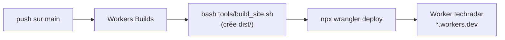

# Déploiement

## Cloudflare Workers

- **Worker** : `techradar` (tableau de bord : Workers & Pages → techradar). C'est un Worker avec *static assets*, pas un projet Pages.
- **Config** : `wrangler.jsonc` — `name: "techradar"` (doit correspondre au Worker), `assets.directory: "./dist"`, pas de code de Worker.
- **Build** (`tools/build_site.sh`) : régénère `feed.xml` (si `python3` est présent) puis copie `index.html`, `feed.xml`, `assets/` et `reports/` dans `dist/`. Sont donc **exclus** : `drafts/`, `tools/`, `.github/`, `.claude/`, `docs/`, README.
- **Réglages Workers Builds** (Settings → Build) :
  - branche de production : `main`
  - build command : `bash tools/build_site.sh`
  - deploy command : `npx wrangler deploy`
  - variable de build optionnelle `SITE_URL` (liens absolus du flux)



Un brief provoque **deux déploiements** : le push du rapport, puis le commit de `feed.xml` par l'Action (volontairement sans `[skip ci]`, pour que le flux déployé soit à jour).

## GitHub Actions

| Workflow | Déclencheur | Rôle |
|---|---|---|
| `feed.yml` | push sur `main` touchant `reports/**`, `tools/build_feed.py` ou `tools/build_memory.py` ; lancement manuel | régénère `feed.xml` **et** `data/memory.json`, et les commit s'ils ont changé |
| `promote.yml` | lancement manuel (entrée : chemin du brouillon) | promeut un brouillon vers `reports/`, régénère le flux et la mémoire, commit |

Variable de dépôt optionnelle : `SITE_URL` (Settings → Variables) pour des liens absolus dans le flux.

## Outils locaux

```bash
python3 tools/build_feed.py [URL_DU_SITE]   # régénère feed.xml
python3 tools/build_memory.py               # régénère data/memory.json
python3 tools/check_report.py <fichier>     # valide un rapport/brouillon (gabarit et règles)
python3 tools/build_memory.py --due 2026-12-01   # rappels de CFP à émettre ce jour-là
python3 tools/build_memory.py --seen <URL>  # URL déjà publiée ?
bash tools/build_site.sh                    # assemble dist/
python3 -m http.server                      # sert le dépôt (l'index lit feed.xml par fetch)
npx wrangler deploy --dry-run               # valide la config Cloudflare sans déployer
```
