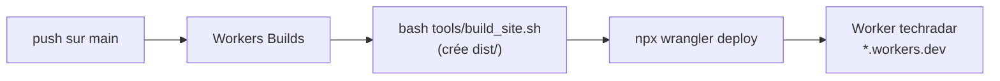

# Déploiement

## Cloudflare Workers

- **Worker** : `techradar` (tableau de bord : Workers & Pages → techradar). C'est un Worker avec *static assets*, pas un projet Pages.
- **Config** : `wrangler.jsonc` — `name: "techradar"` (doit correspondre au Worker), `assets.directory: "./dist"`, pas de code de Worker.
- **Build** (`tools/build_site.sh`) : régénère `feed.xml` (si `python3` est présent) puis copie `index.html`, `feed.xml`, `assets/` et `reports/` dans `dist/`. Sont donc **exclus** : `drafts/`, `tools/`, `.github/`, `.claude/`, `docs/`, README.
- **Réglages Workers Builds** (Settings → Build) :
  - branche de production : `main`
  - build command : `bash tools/build_site.sh`
  - deploy command : `npx wrangler deploy`
  - variable de build `SITE_URL` = `https://techradar.reefact.net` (texte, pas un secret ; sans elle, les liens du flux restent relatifs) ;
  - **Build watch paths**, inclusions : `index.html, assets/*, reports/*, wrangler.jsonc, tools/build_site.sh, tools/build_feed.py` (exclusions : aucune). Un push qui ne touche aucun de ces fichiers (docs, drafts, data, skills, workflows…) ne déclenche pas de build. Un push **sans aucun fichier modifié** (commit vide) en déclenche toujours un : c'est le moyen de forcer un déploiement ;



Un brief provoque **un seul déploiement** (le push du rapport) : le commit de l'Action sur `feed.xml` et `data/memory.json` ne touche aucun chemin surveillé, et le flux servi est régénéré pendant le build.

## GitHub Actions

| Workflow | Déclencheur | Rôle |
|---|---|---|
| `feed.yml` | push sur `main` touchant `reports/**`, `tools/build_feed.py` ou `tools/build_memory.py` ; lancement manuel | régénère `feed.xml` **et** `data/memory.json`, et les commit s'ils ont changé |
| `promote.yml` | lancement manuel (entrée : chemin du brouillon) | promeut un brouillon vers `reports/`, régénère le flux et la mémoire, commit |

Variable de dépôt `SITE_URL` (Settings → Secrets and variables → Actions → Variables) = `https://techradar.reefact.net`, pour les liens absolus du `feed.xml` commité. Le flux réellement servi est celui régénéré par le build Cloudflare, qui lit sa propre variable `SITE_URL` (voir plus haut) : les deux doivent être définies.

## Outils locaux

```bash
python3 tools/build_feed.py [URL_DU_SITE]   # régénère feed.xml
python3 tools/build_memory.py               # régénère data/memory.json
python3 tools/check_report.py <fichier>     # valide un rapport/brouillon (gabarit et règles)
python3 tools/build_memory.py --due 2026-12-01   # rappels de CFP à émettre ce jour-là
python3 tools/build_memory.py --seen <URL>  # URL déjà publiée ?
bash tools/build_site.sh                    # assemble dist/
python3 -m http.server                      # sert le dépôt (l'index lit feed.xml par fetch)
npx wrangler deploy --dry-run               # valide la config Cloudflare sans déployer
```

## Adresse du site

Le site est servi sur https://techradar.reefact.net/ (domaine attaché au Worker). Les URL `…/reports/AAAA/AAAAMMJJ.html` redirigent (307) vers la même adresse sans `.html` : comportement par défaut de Cloudflare (`html_handling`), sans conséquence ; l'index et le CSS se chargent normalement. Ne pas passer `html_handling` à `none` sans test : la gestion de la racine `/` en dépend.
