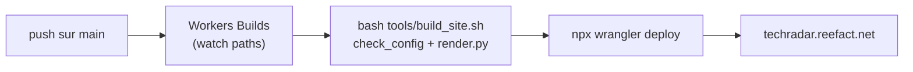

# Déploiement

## Cloudflare Workers

- **Worker** : `techradar` (Workers & Pages → techradar), site statique (*static assets*), servi sur **https://techradar.reefact.net/**.
- **Config** : `wrangler.jsonc` — `name: "techradar"`, `assets.directory: "./dist"`, pas de code de Worker.
- **Build** (`tools/build_site.sh`) : contrôle de la configuration (`check_config.py`, le build échoue si elle est incohérente), rendu de tous les jours (`render.py` : `reports/`, `dossier/AAAA/`, `dossier/dossier.json`, `feed.xml`), copie de l'interface (`index.html`, `dossier/index.html`, `assets/`), puis `_headers` (pas d'indexation de `/dossier`) et `_redirects` (`/drafts` → `/dossier/`). Rien d'autre n'est publié (`config/`, `data/`, `tools/`, `docs/` restent dans le dépôt).
- **Réglages Workers Builds** (Settings → Build) :
  - branche de production : `main` ;
  - build command : `bash tools/build_site.sh` ; deploy command : `npx wrangler deploy` ;
  - variable de build `SITE_URL` = `https://techradar.reefact.net` (liens absolus du flux) ;
  - **build watch paths**, inclusions : `index.html, assets/*, dossier/*, data/days/*, config/*, tools/render.py, tools/veille_lib.py, tools/check_config.py, tools/build_site.sh, wrangler.jsonc`. Un push qui ne touche aucun de ces fichiers (docs, mémoire, skills, workflows…) ne déclenche pas de build ; un push **sans fichier modifié** (commit vide) en déclenche toujours un.



Les URL `…/reports/AAAA/AAAAMMJJ.html` redirigent (307) vers la même adresse sans `.html` (comportement par défaut de Cloudflare) : sans conséquence.

## GitHub Actions

| Workflow | Déclencheur | Rôle |
|---|---|---|
| `memory.yml` | push sur `main` touchant `data/days/**`, `config/**` ou les outils de mémoire et de contrôle ; lancement manuel | contrôle la configuration et les fichiers du jour (visible dans l'onglet Actions) ; régénère `data/memory.json` et le commite s'il a changé |

## Outils locaux

```bash
python3 tools/check_config.py                              # configuration cohérente ?
python3 tools/check_day.py data/days/2026/20261124.json    # un jour valide ? (--contre HEAD, --partiel)
python3 tools/statut.py list 2026-11-24                    # sujets par statut
bash tools/build_site.sh                                   # construit dist/ comme Cloudflare
python3 -m http.server -d dist                             # puis http://localhost:8000/ et /dossier/
python3 tools/build_memory.py --seen <URL>                 # déjà vue ? publiée ?
npx wrangler deploy --dry-run                              # valide la config Cloudflare sans déployer
```

L'index lit `feed.xml` et la page du dossier lit `dossier/dossier.json` par `fetch` : il faut un serveur HTTP (pas `file://`).

## Adresse et réseau

Le domaine `techradar.reefact.net` est attaché au Worker. Certains réseaux d'entreprise ne le résolvent pas (DNS filtrant les domaines récents) : le site reste accessible depuis un autre réseau.
