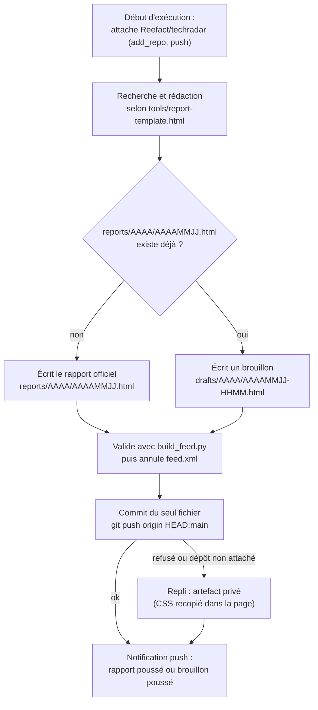

# Génération des rapports

## La tâche planifiée

- **Nom** : « Veille technologique quotidienne » — identifiant `trig_01AnnpgLeWuVJx74hwcCpTg1`.
- **Planning** : du lundi au vendredi, 6h06 heure de Paris. Le brief doit être publié avant 8h.
- **Nature** : ta veille technologique personnelle, menée dans le cadre de tes missions Reefact ; une tâche planifiée Claude (session cloud « Cowork »), modèle Sonnet, mode non surveillé. Elle fait de la recherche web, rédige en français et publie.
- **Où vit son prompt** : *uniquement dans la tâche* (pas versionné dans Git). Pour le relire : demander à Claude de lister les tâches planifiées, ou consulter la tâche dans claude.ai.
- **Mémoire** : un artefact privé « Veille — registre » (anti-doublons, suivi des CFP, outils déjà proposés, outils du radar).

### Contenu d'un brief (résumé du prompt)
| Section | Idée |
|---|---|
| Alertes & incidents | failles, pannes ; touché / correctif / gravité / « te concerne ? » |
| Radar de tes projets | seulement s'il y a du nouveau (kill-mutants, unified-assertions, just-dummies, first-class-errors, conventional-comments-toolkit, slugger, enum-member-name-binding, design-pattern-catalog) |
| .NET, IA, DDD, API & architecture | minimums et plafonds par catégorie |
| Outils du moment | 3 à 5 outils dont une « pépite » ; jamais re-proposés sans grosse nouveauté |
| Distribution | enseignes, cyberattaques, retail media |
| Conférences & CFP | suivi exhaustif, rappels J-30 / J-14 / J-7 / J-3 |
| En bref | 5 à 10 lignes |

`api-contract-guardrails` est exclu du radar. Règle générale : un sujet déjà publié ne revient que s'il y a une grosse nouveauté (présenté comme « Mise à jour »).

## Publication (section 6 du prompt)

Règles décidées :
- **Push direct sur `main`**, jamais de branche ni de PR.
- **Jamais d'écrasement** d'un rapport déjà publié : une relance produit un brouillon dans `drafts/`.
- La tâche ne commite **que** son fichier ; `feed.xml` est géré par l'Action.

## Brouillons et promotion

Les brouillons (`drafts/`) n'apparaissent ni dans l'index ni dans le flux. Ils se consultent sur https://techradar.reefact.net/drafts/ (même interface que l'accueil, navigation par date et heure, non indexée par les moteurs). Pour en choisir un :
- **GitHub** : Actions → « Promote a draft report » → Run workflow → saisir le chemin (`drafts/2026/20261124-0815.html`). L'Action copie le brouillon vers `reports/`, régénère le flux et commit sur `main`. Le chemin est validé (format strict).
- **Skill Claude Code** : `/promote-draft` dans une session sur ce dépôt ; il liste les brouillons, demande confirmation, lance le workflow et vérifie le résultat.
- **À la main** : copier le fichier vers `reports/AAAA/AAAAMMJJ.html`, lancer `python3 tools/build_feed.py`, commiter.

L'ancienne version reste dans l'historique Git.

**Régénérer un rapport** (jour courant ou date choisie ; rattrapage d'un jour manqué possible) : skill `veille-regenerer`, qui demande la date. Il lance la tâche avec une consigne de régénération ; elle écrit toujours un brouillon. Au choix : en rester là (brouillon), ou « écraser » = contrôle (`tools/check_report.py`), accord explicite, puis promotion via le workflow. Le prompt de la tâche n'est pas modifié : il continue d'interdire l'écrasement direct.

## Mémoire côté dépôt (outillage prêt, pas encore branché sur la tâche)

Aujourd'hui la tâche s'appuie sur l'artefact « Veille — registre ». En parallèle, le dépôt sait reconstruire cette mémoire à partir des rapports eux-mêmes :

- `tools/build_memory.py` lit tous les `reports/**/*.html` et écrit `data/memory.json` (déterministe, sans horodatage) :
  - `topics` : chaque sujet publié (date, catégorie, titre, sources, dépôt du radar) et chaque ligne « En bref » ;
  - `urls` : toutes les URL déjà citées, avec date et rapport de première apparition (anti-doublon) ;
  - `tools_proposed` : les outils déjà proposés ;
  - `conferences` : tableau (dates, lieu, dates limites de CFP lues quand elles ont une année) et rappels ⏰ déjà émis, déduits des badges des rapports ;
  - `radar` : les signaux publiés par dépôt.
- `--seen <URL>` répond « déjà publié ? » ; `--due [date]` liste les rappels J-30/14/7/3 à émettre (seuil atteint et aucun badge ⏰ du même seuil dans un rapport).
- `data/notes.md` garde ce qui n'est pas déductible : préférences, dernières versions vues, liste de surveillance du radar, vérifications en attente. Repris du registre au 24/11/2026.
- L'Action `feed.yml` régénère `data/memory.json` à chaque push dans `reports/`.
- Le skill Claude Code `veille-memoire` interroge et met à jour tout cela.

Écart connu avec l'artefact : celui-ci indiquait un rappel DevSum « J-14 » envoyé le 24/11 alors que le rapport du jour n'affiche pas de badge ⏰ pour DevSum. La mémoire du dépôt ne connaît que ce que les rapports montrent, donc elle considère ce rappel comme non émis.

Pour basculer la tâche sur cette mémoire : lui faire lire `data/memory.json` et `data/notes.md` à la place de l'artefact (dépend du même accès au dépôt que la publication), puis arrêter de republier l'artefact.

## Qualité du français

Un contrôle automatique ne peut pas garantir un français idiomatique ; il y a donc trois niveaux complémentaires :
1. **Relecture par la tâche** (§5bis du prompt, avant publication) : critères explicites (calques, phrases courtes, compréhensible seul, ton, exactitude), une première relecture par la tâche puis, si possible, un sous-agent relecteur indépendant.
2. **Signaux automatiques** : `tools/check_report.py` affiche des lignes « ? (langue) » non bloquantes : paragraphes qui ressemblent à de l'anglais, calques courants (« supporte », « adresse un problème », « impacter »…), phrases de plus de 45 mots, restes de gabarit. Ils ne prouvent rien : ils désignent ce qu'il faut relire.
3. **Relecture à la demande** : skill `veille-relecture` (Claude Code), applicable à n'importe quel rapport ou brouillon.

## Prompt de la tâche : amorçage + prompt dans le dépôt

Pour ne plus recopier le prompt à chaque modification, la tâche peut ne contenir qu'un **prompt d'amorçage** (`tools/veille-bootstrap.md`, à coller une fois) qui lui dit de lire `tools/veille-prompt.md` dans le dépôt cloné et de l'appliquer. Le vrai prompt est alors versionné et prend effet dès le brief suivant.

À savoir :
- Toute modification de `tools/veille-prompt.md` sur `main` s'applique au brief suivant, **sans relecture automatique** : après un changement important, lancer le skill `veille-test`.
- Si le dépôt n'est pas cloné ou si le fichier est illisible, la tâche ne produit rien et envoie une notification (plutôt que d'improviser).
- Quelques garde-fous sont répétés dans le prompt d'amorçage (jamais de force-push, push sur `main` seulement, aucune modification des fichiers d'instructions, aucun écrasement d'un rapport publié) pour qu'ils tiennent même si le fichier était modifié par erreur.
- Qui peut écrire sur `main` peut changer le comportement de la tâche : à garder en tête si le dépôt a d'autres contributeurs.

## Jours fériés et lancements manuels

Le saut d'un jour férié ne s'applique qu'à l'exécution **planifiée** (jour ouvré, démarrage entre 05:45 et 07:00 heure de Paris). Tout lancement manuel (« Run now », ou un jour/une heure hors planning) produit toujours un rapport : on peut donc forcer un brief n'importe quand. Limite : un lancement manuel un jour férié entre 05:45 et 07:00 serait pris pour l'exécution planifiée et sauté ; le relancer après 07:00.
