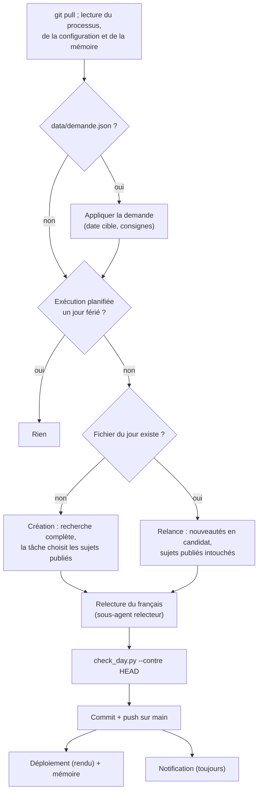

# Génération de la veille

## La tâche planifiée

- **Nom** : « Tech Radar (Reefact) » — identifiant `trig_01LAptLYqsefHr97oCdi9AiY` ; https://claude.ai/code/routines/trig_01LAptLYqsefHr97oCdi9AiY
- **Planning** : du lundi au vendredi, 6h06 heure de Paris ; publication avant 8h.
- **Dépôt** : `Reefact/techradar`, attaché à la tâche (cloné à chaque exécution, push direct sur `main`).
- **Environnement** : « Par défaut » (réseau ouvert, nécessaire à la recherche web). Aucun connecteur.
- **Prompt** : un texte d'**amorçage** ([`tools/veille-bootstrap.md`](../tools/veille-bootstrap.md)) collé une fois dans la tâche ; il lui fait lire le **processus** ([`tools/veille-prompt.md`](../tools/veille-prompt.md)), qui lui fait lire la **configuration** (`config/`). Modifier ces fichiers sur `main` suffit : rien à recopier.
- **Lancement manuel** : « Run now » sur la page de la tâche (un agent ne peut pas la lancer, et « Run now » ne transmet pas de consigne : la consigne passe par `data/demande.json`).

L'ancienne tâche « Veille technologique quotidienne » (artefact privé) est à désactiver une fois la nouvelle validée.

## Trois niveaux de consignes

| Niveau | Fichier | Change quand… |
|---|---|---|
| Amorçage | `tools/veille-bootstrap.md` (copié dans la tâche) | presque jamais ; il faut alors le recoller dans la tâche |
| Processus | `tools/veille-prompt.md` | on change la façon de travailler (format, validation, publication) |
| Quoi chercher | `config/` | on change le périmètre (skill `veille-sujets`) |

## Une exécution

- **Recherche** : par catégorie active, selon `config/sujets/recherche/*.json`, `outils.json`, `projets.json`, `conferences.json` ; les éléments « toujours suivis » sont vérifiés à chaque fois (consignés dans le journal s'il n'y a rien de neuf), les « exclus » ne sont jamais affichés.
- **Tri** : chaque sujet analysé reçoit un statut ; seuls les sujets publiés un jour précédent bloquent l'anti-doublon.
- **Journal** : nombre de recherches par catégorie, pages ouvertes, sources illisibles, vérifications, hypothèses ; au moins 30 sujets analysés (`analyses_min`).
- **Relance** : un sujet publié n'est jamais modifié par la tâche (le validateur le vérifie avec `--contre HEAD`) ; l'utilisateur publie ensuite ce qu'il veut parmi les candidats.

## Après coup : publier, relancer, relire

| Besoin | Moyen |
|---|---|
| Publier un candidat, retirer un sujet, écarter | skill `veille-publier` (ou boutons « Demander la publication » / « Demander le retrait » du dossier, qui ouvrent une session Claude Code, puis la notation du sujet) |
| Relancer la veille d'un jour, avec consignes | skill `veille-regenerer` (écrit `data/demande.json`, puis « Run now ») |
| Corriger le français | skill `veille-relecture` |
| Changer ce qu'on cherche | skill `veille-sujets` |
| Vérifier une exécution | skill `veille-test` |

L'historique Git de `data/days/AAAA/AAAAMMJJ.json` garde toutes les versions d'un jour.

## Contrôles

- `python3 tools/check_front.py` (lancé par le build et par `check_day.py`) : tout ce qu'affichent les blocs et la barre de filtres vient de `config/` à l'identique (libellé et classe de la catégorie, tags déclarés et affichés une fois, projet déclaré, puces de filtre) ; aucun libellé propre à un sujet. Tests : `python3 -m unittest discover -s tests` (lancés aussi par le build, qui échoue au moindre écart).
- `python3 tools/check_config.py` : configuration cohérente (clés, préfixes, index, fichiers de recherche, dépôts des projets).
- `python3 tools/check_day.py <jour.json> [--contre REF] [--partiel]` : schéma, catégories et tags connus, titres de 72 caractères au plus, dépôts des projets, minimums et plafonds (hors sujets des projets), « À retenir » (3 à 5), `date` des sujets publiés et candidats, pas de champ `en_bref`, vérification des sources (catégories à risque sans source de référence, verdicts, format du bloc `verification`), motifs des écartés, éléments toujours suivis vérifiés, exclusions respectées, nombre de sujets analysés, immuabilité des sujets publiés, puis rendu et contrôle du HTML (structure, liens, signaux de langue « ? »).
- L'Action `memory.yml` lance ces contrôles à chaque push (onglet Actions de GitHub) et régénère `data/memory.json`.

## Mémoire

`data/memory.json` est dérivée des jours : sujets (avec statut et motif), URL vues (une URL publiée prime), outils proposés, conférences et rappels de CFP émis, sujets de chaque projet. Commandes : `--seen <URL>`, `--due <date>`, `--reconsiderer`. `data/notes.md` garde le reste.

## Qualité du français

1. **Relecture par la tâche** (processus §5) : critères explicites, relecture puis sous-agent relecteur indépendant, nombre de corrections dans la note d'exécution.
2. **Signaux automatiques** : lignes « ? langue » de `check_day.py` (anglais résiduel, calques, phrases de plus de 45 mots).
3. **Relecture à la demande** : skill `veille-relecture`.

## Jours fériés et lancements manuels

Le saut d'un jour férié ne s'applique qu'à l'exécution **planifiée** (jour ouvré, démarrage entre 05:45 et 07:00, heure de Paris). Tout lancement manuel produit un résultat. Limite : un lancement manuel un jour férié entre 05:45 et 07:00 serait pris pour l'exécution planifiée ; relancer après 07:00.
